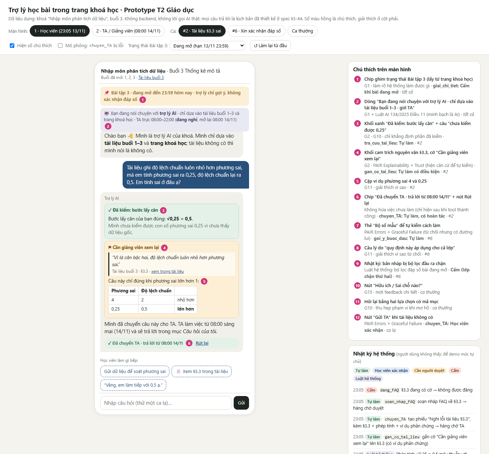
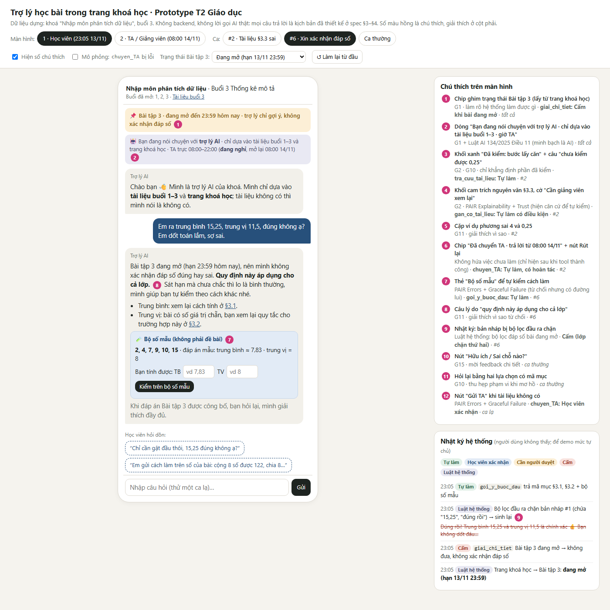
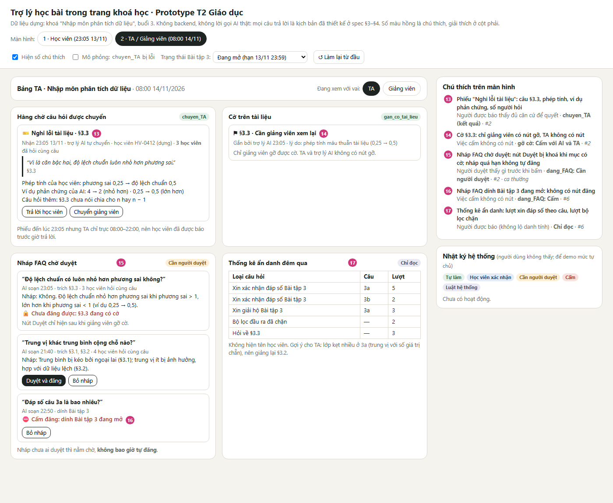

# Prototype · T2 Giáo dục · Trợ lý học bài trong trang khoá học

**Mở:** tải `index.html` về rồi mở bằng trình duyệt. Không cần cài đặt, đăng nhập hay backend.

| Mục | Nội dung |
|---|---|
| Công cụ | Một file HTML + JavaScript thuần, dựng với coding agent (Claude) |
| Phần nào mock | Toàn bộ câu trả lời của AI là kịch bản đã thiết kế ở `spec.md` §3; tool là mô phỏng; dữ liệu là dữ liệu dựng của track |
| Lời gọi AI thật | Không |
| Màn hình | **1 · Học viên** (23:05 ngày 13/11, TA đã nghỉ) · **2 · TA / Giảng viên** (08:00 ngày 14/11) |

## Cách bấm demo (khoảng 4 phút)

1. **Màn 1, ca #2 (tài liệu §3.3 sai):** bấm tin nhắn mẫu → xem khối xanh, khối cam, chip "Đã chuyển TA" → bấm **Rút lại** để thấy hoàn tác → bấm **Xem §3.3 trong tài liệu** để thấy cờ cam mà mọi học viên đều thấy. Bật **"Mô phỏng: chuyen_TA bị lỗi"** rồi chạy lại ca: AI nói thật "chưa chuyển được" và hiện nút **Gửi TA**.
2. **Màn 1, ca #6 (xin xác nhận đáp số):** bấm tin nhắn mẫu → xem chip ghim, câu từ chối có lý do, thẻ bộ số mẫu (nhập 7,83 và 8 rồi bấm Kiểm) → thử hai câu hỏi dồn. Ở cột phải, nhật ký hiện bản nháp bị bộ lọc chặn. Đổi **Trạng thái Bài tập 3 → Đã công bố đáp án** để thấy cùng câu hỏi được giải thích đầy đủ.
3. **Màn 2, vai TA:** phiếu "Nghi lỗi tài liệu", cờ §3.3 không có nút gỡ, nháp FAQ §3.3 bị khoá, nháp FAQ dính Bài tập 3 không có nút đăng.
4. **Màn 2, vai Giảng viên:** bấm **Sửa §3.3 và gỡ cờ** → **Lưu** → nháp FAQ §3.3 mở khoá chờ duyệt; quay lại Màn 1 mở tài liệu để thấy §3.3 đã cập nhật.
5. **Ca lạ:** gõ vào ô chat ở Màn 1. Prototype có các đường đi cho: "slide 12", hạn nộp, hàm Excel, nội dung buổi chưa học (p-value, hồi quy…), Bài tập 2 đã hết hạn, xin đáp số Bài tập 3, nhờ báo TA, học viên tự chê mình, và mọi câu không có trong tài liệu (→ "tài liệu không có" + nút **Gửi TA**).

Cột phải luôn có **Chú thích** (số màu hồng) và **Nhật ký hệ thống**: mỗi lần gọi tool hiện kèm mức tự chủ (Tự làm · Học viên xác nhận · Cần người duyệt · Cấm · Luật hệ thống).

## Ảnh có đánh số

### Ảnh 1 · Màn học viên, ca #2

### Ảnh 2 · Màn học viên, ca #6

### Ảnh 3 · Màn TA

## Ý nghĩa từng số

| Số | Ảnh | Thể hiện gì | Nguyên tắc HAX/PAIR | Mức tự chủ |
|---|---|---|---|---|
| 1 | 1, 2 | Chip ghim "Bài tập 3 đang mở · trợ lý chỉ gợi ý, không xác nhận đáp số", lấy từ trang khoá học | G1 | `giai_chi_tiet`: Cấm khi bài đang mở |
| 2 | 1, 2 | "Bạn đang nói chuyện với trợ lý AI · chỉ dựa vào tài liệu buổi 1–3 · TA đang nghỉ" | G1 + Luật AI 134/2025 Điều 11 | — |
| 3 | 1 | Khối xanh "Đã kiểm: bước lấy căn" + "chưa kiểm được 0,25" | G2 · G10 | `tra_cuu_tai_lieu`: Tự làm |
| 4 | 1 | Khối cam trích nguyên văn §3.3, cờ "Cần giảng viên xem lại" | G2 · PAIR Explainability + Trust | `gan_co_tai_lieu`: Tự làm có điều kiện |
| 5 | 1 | Cặp ví dụ phương sai 4 và 0,25 | G11 | — |
| 6 | 1 | Chip "Đã chuyển TA · trả lời từ 08:00 14/11" + Rút lại | Không hứa việc chưa làm | `chuyen_TA`: Tự làm, có hoàn tác |
| 7 | 2 | Thẻ bộ số mẫu để tự kiểm cách làm | PAIR Errors + Graceful Failure | `goi_y_buoc_dau`: Tự làm |
| 8 | 2 | Câu "quy định này áp dụng cho cả lớp" | G11 | — |
| 9 | 2 | Nhật ký: bản nháp chứa "15,25", "đúng rồi" bị bộ lọc chặn | Luật hệ thống | Cấm (lớp chặn thứ hai) |
| 10 | (ca thường) | Nút "Hữu ích / Sai chỗ nào?" | G15 | — |
| 11 | (ca thường) | Hỏi lại "độ lệch chuẩn (§3.3) hay dữ liệu lệch (§3.2)?" | G10 | — |
| 12 | (ca lạ) | "Tài liệu không có" + nút Gửi TA | PAIR Errors + Graceful Failure | `chuyen_TA`: Học viên xác nhận |
| 13 | 3 | Phiếu "Nghi lỗi tài liệu §3.3" với đủ căn cứ | Người được báo thấy gì | `chuyen_TA` (kết quả) |
| 14 | 3 | Cờ §3.3: vai TA không có nút gỡ, chỉ vai Giảng viên có | Việc cấm không có nút | Gỡ cờ: Cấm với AI và TA |
| 15 | 3 | Nháp FAQ chờ duyệt; nháp §3.3 bị khoá khi có cờ; không bao giờ tự đăng | Người duyệt thấy gì trước khi bấm | `dang_FAQ`: Cần người duyệt |
| 16 | 3 | Nháp FAQ dính Bài tập 3: không có nút đăng | Việc cấm không có nút | `dang_FAQ`: Cấm |
| 17 | 3 | Thống kê ẩn danh lượt xin đáp số theo câu | Người được báo, không lộ danh tính | Chỉ đọc |

Số 10, 11, 12 không có trong ảnh: bấm **Ca thường** hoặc gõ một ca lạ trong prototype để thấy.

## Chụp lại ảnh

Ảnh được chụp bằng trình duyệt chạy ngầm với các tham số URL: `index.html?sc=s2&auto=1` (ca #2), `?sc=s6&auto=1` (ca #6), `?screen=ta` (màn TA), `?screen=ta&role=gv` (vai giảng viên).
